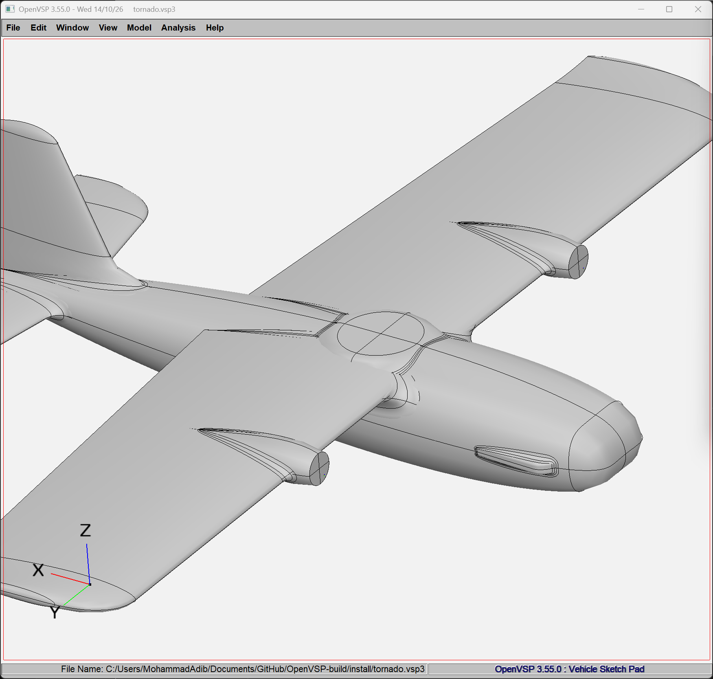
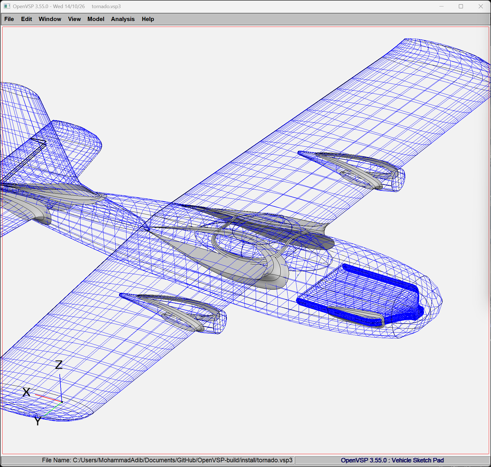
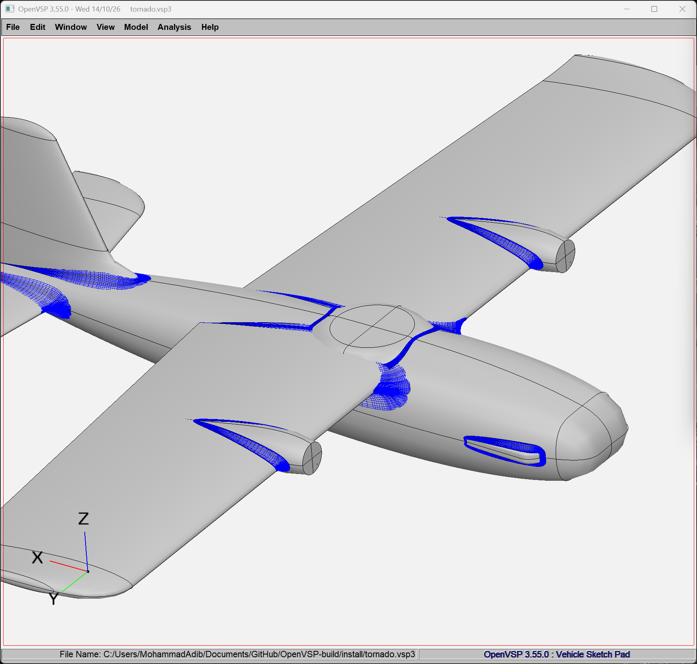
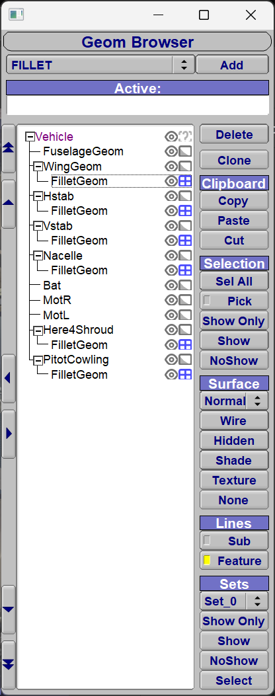
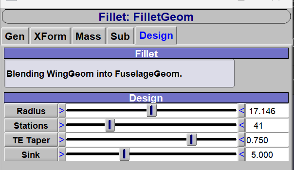

# TitanVSP

TitanVSP is [OpenVSP](https://github.com/OpenVSP/OpenVSP) **3.55.0** with a **Fillet**
component that blends wings and fuselages into each other with smooth rolling-ball
fillets, a dark theme, a perspective view, the system file dialog, and Windows scripts that
build and launch it in one step. Everything else is upstream OpenVSP, unchanged.

**What's changed:** every change from upstream OpenVSP is listed in [CHANGES.md](CHANGES.md).

**Download:** a ready-to-run Windows build is on the
[Releases](https://github.com/Titan-Dynamics/TitanVSP/releases) page.

- [About OpenVSP](#about-openvsp)
- [Build and run](#build-and-run)
- [What's new in TitanVSP](#whats-new-in-titanvsp)
- [Keeping up with upstream](#keeping-up-with-upstream)
- [License](#license)




<p>
  
  
</p>

## About OpenVSP

OpenVSP is a parametric aircraft geometry tool. You build a 3D model of an aircraft from common
engineering parameters (spans, chords, airfoils, fuselage sections), and OpenVSP processes it
into formats for engineering analysis: meshes, CFD and structures inputs, degenerate geometry,
and its own VSPAERO solver. It also has a C++ API, Python bindings and AngelScript scripting.

It was developed for NASA by JR Gloudemans and others from the early 1990s, and was released as
open source under the NASA Open Source Agreement (NOSA) 1.3 in January 2012.

- Website: <https://openvsp.org>
- Upstream source: <https://github.com/OpenVSP/OpenVSP>
- Releases: <https://github.com/OpenVSP/OpenVSP/releases>
- Wiki: <https://openvsp.org/wiki/>
- Community forum: <https://groups.google.com/g/openvsp>
- Full dependency list and Linux/macOS build instructions: the
  [upstream README](https://github.com/OpenVSP/OpenVSP/blob/main/README.md)

## Build and run

### Windows

The `dev\` scripts build everything, install it next to the repo, and launch it.

**1. Install the prerequisites** (once):

| Tool | Install |
| --- | --- |
| Visual Studio 2022 with the *Desktop development with C++* workload | [visualstudio.microsoft.com](https://visualstudio.microsoft.com/) |
| Git | `winget install Git.Git` |
| CMake | `winget install Kitware.CMake` |
| SWIG (for the Python API) | `winget install SWIG.SWIG` |
| Python 3 with numpy | `winget install Python.Python.3.11`, then `python -m pip install numpy` |
| Pandoc (optional, for the in-app help) | `winget install JohnMacFarlane.Pandoc` |

**2. Clone, build and launch:**

```powershell
git clone https://github.com/Titan-Dynamics/TitanVSP.git
cd TitanVSP
powershell -ExecutionPolicy Bypass -File dev\run.ps1
```

The first build compiles the third-party libraries too and takes a while. After that, builds are
incremental.

**3. Optional:** add a one-click "TitanVSP (Dev)" shortcut to the Desktop and Start Menu. It
rebuilds whatever you've changed, then launches:

```powershell
powershell -ExecutionPolicy Bypass -File dev\install-shortcut.ps1
```

| Script | What it does |
| --- | --- |
| `dev\build.ps1` | Builds the libraries (first time only) and OpenVSP, and installs it. `-Clean` rebuilds OpenVSP from scratch; `-CleanAll` rebuilds the libraries too. |
| `dev\run.ps1` | Incremental build, then launches `vsp.exe`. `-NoBuild` just launches the last build. |
| `dev\install-shortcut.ps1` | Creates the "TitanVSP (Dev)" shortcut, which runs `run.ps1`. |

The build output lives next to the repo, not inside it:

```
<parent>\TitanVSP                 this repo
<parent>\OpenVSP-build\Libraries  third-party libraries (built once)
<parent>\OpenVSP-build\vsp        OpenVSP build tree
<parent>\OpenVSP-build\install    runnable OpenVSP: vsp.exe and its resources
<parent>\OpenVSP-build\vsp\venv   Python venv with the openvsp package
```

Close OpenVSP before rebuilding. A running `vsp.exe` can't be overwritten, so the install
step fails with `file INSTALL cannot copy file`. The Python module is still rebuilt.

**Python API.** The build creates a venv with the `openvsp` package installed in editable mode
from the build tree. After you rebuild, it uses the new bindings automatically:

```powershell
..\OpenVSP-build\vsp\venv\Scripts\Activate.ps1
python -c "import openvsp as vsp; print(vsp.GetVSPVersion())"
```

See [dev/README.md](dev/README.md) for more on the scripts.

### Linux and macOS

TitanVSP's changes are plain C++ in the normal source tree, so follow the
[upstream build instructions](https://github.com/OpenVSP/OpenVSP/blob/main/README.md).
Using the SuperProject is the easy route. TitanVSP has only been built and tested on Windows.

## What's new in TitanVSP

This section covers the main features. [CHANGES.md](CHANGES.md) lists every change from
upstream OpenVSP. If you're working on the code, including with a coding agent, start with
[AGENTS.md](AGENTS.md), which explains how the fork's code works.

### Fillet component

A **Fillet** blends one component into another with a smooth, concave rolling-ball fillet, the
shape a ball of fixed radius sweeps as it rolls along the junction touching both parts. It covers
two kinds of join:

| Add the Fillet to | It blends into | Shape |
| --- | --- | --- |
| a **Wing** | the Fuselage, Pod or Stack its root is buried in | Runs round the wing root from the lower trailing edge to the upper one, and tapers to a point at each end of the trailing edge |
| a **Fuselage, Pod or Stack** | the Fuselage, Pod, Stack or **Wing** it overlaps most: a canopy, a pod or boom, a fuselage set into a wing | A closed ring round each loop where they meet; a body passing right through another gets two rings |

The Fillet finds the other part on its own. It is a separate, closed, watertight body overlapping
both parts, and it leaves them untouched.

#### In the GUI

1. In the Geom Browser, select the wing or fuselage the fillet should hang off.
2. Pick **FILLET** in the type list next to **Add**, then click **Add**.
3. Open the new Fillet. Its **Design** tab shows a status line saying what it is blending into,
   and these parameters:

| Parameter | Default | What it does |
| --- | --- | --- |
| **Radius** | 0 (auto) | Radius of the rolling ball. At 0, the first build picks 8% of the wing's chord at the root, or 8% of the slimmer body's thickness for body joins, and fills it in. |
| **Stations** | 41 (9–401) | Number of cross-sections round the junction. More are added automatically wherever the fillet turns quickly. |
| **TE Taper** | 0.15 (0–1) | Wing roots only. The fraction of each side of the junction over which the radius tapers to nothing at the trailing edge. On body fillets it's 0 and greyed out. |
| **Sink** | 1.0 | How far the fillet's face carries on past where it touches each part, easing just under the surface, so it fades in instead of ending on a line. It's in model units and capped at 4 × Radius. |

The Fillet rebuilds automatically whenever either part moves or changes. Its own position,
rotation and symmetry are fixed (greyed out), because it's built in place. Each mirrored copy of
a symmetric part gets its own fillet. Fillets save and load with the `.vsp3`, and export like any
other component: STL, CompGeom and so on. For a single seamless body, union the fillet with the
parts it joins, for example with a boolean in Blender on the STL export.

#### From Python

```python
import openvsp as vsp

vsp.ReadVSPFile('model.vsp3')

# Wing root into the fuselage its root is buried in.
wing = vsp.FindGeomsWithName('WingGeom')[0]
root_fillet = vsp.AddGeom('FILLET', wing)

# A second fuselage into whatever it overlaps most -- another fuselage or a wing -- with a chosen
# radius.
pod = vsp.FindGeomsWithName('Fuselage2')[0]
pod_fillet = vsp.AddGeom('FILLET', pod)
vsp.SetParmVal(pod_fillet, 'Radius', 'Design', 4.0)
vsp.SetParmVal(pod_fillet, 'Sink', 'Design', 0.5)

vsp.Update()

# Export just the fillets to STL.
for g in vsp.FindGeoms():
    vsp.SetSetFlag(g, vsp.SET_FIRST_USER, g in (root_fillet, pod_fillet))
vsp.ExportFile('fillets.stl', vsp.SET_FIRST_USER, vsp.EXPORT_STL)
```

The parameters are `Radius`, `NumStations`, `TETaper` and `Sink`, all in the `Design` group.
`AddGeom('FILLET', parent)` fails if the parent isn't a Wing, Fuselage, Pod or Stack.

#### Limits

- A wing fillet only blends the wing's **root** (its first section) into a body. Mid-span
  wing-to-wing joins aren't supported.
- A body join must be a closed loop that doesn't cross a flat end cap or a sharp edge. For
  example, a boom exiting through a fuselage's flat tail cap won't fillet.
- **Sink** is in absolute model units. On small models (the default 30-unit fuselage, say),
  1 unit is large, so turn it down.
- If the ball can't fit all the way round a junction, the status line says so; try a smaller
  **Radius**.
- A rebuild takes about 0.1–1.5 s, depending on the junction.

### Dark theme

The interface, window title bars and 3D view are dark. Components draw in light grey, and the
selected one is outlined in white.

### Perspective view

**View → Perspective** (key **5**) switches the 3D view between orthographic and perspective,
keeping the same framing.

### System file dialog

Open, save, import and export use the Windows file dialog. OpenVSP's own chooser is still
under **File → Preferences… → File Chooser**.

### Windows dev scripts

`dev\build.ps1`, `dev\run.ps1` and `dev\install-shortcut.ps1`, described
[above](#build-and-run).

### Python API in the dev build

The Windows build enables the Python API and sets up a venv with the bindings, as
[above](#build-and-run).

## Keeping up with upstream

TitanVSP's history starts with one commit importing OpenVSP 3.55.0 (upstream tag
`OpenVSP_3.55.0`), with TitanVSP's own changes on top. OpenVSP's full history stays in the
[upstream repository](https://github.com/OpenVSP/OpenVSP).

To move to a newer OpenVSP release, apply upstream's changes between the two releases as one
commit. For example, for 3.56.0:

```powershell
git remote add upstream https://github.com/OpenVSP/OpenVSP.git   # once
git fetch upstream --tags
git diff --binary OpenVSP_3.55.0 OpenVSP_3.56.0 | git apply -3
git commit -m "Update to OpenVSP 3.56.0"
```

`-3` falls back to a three-way merge wherever TitanVSP changed the same lines, and leaves any
conflicts for you to resolve as usual. Don't push the upstream tags (`git push --tags`), or
OpenVSP's release tags will show up in TitanVSP.

## License

TitanVSP is a modified version of OpenVSP, under the same license as upstream: the NASA Open
Source Agreement (NOSA) version 1.3. See [LICENSE](LICENSE). OpenVSP builds on many third-party
libraries, credited in the [upstream README](https://github.com/OpenVSP/OpenVSP/blob/main/README.md).
